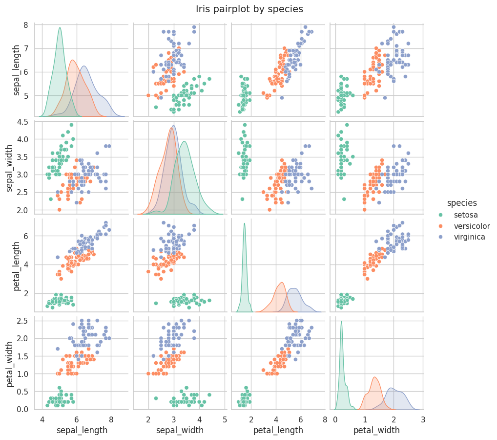
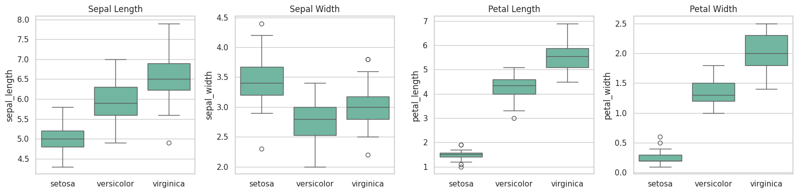
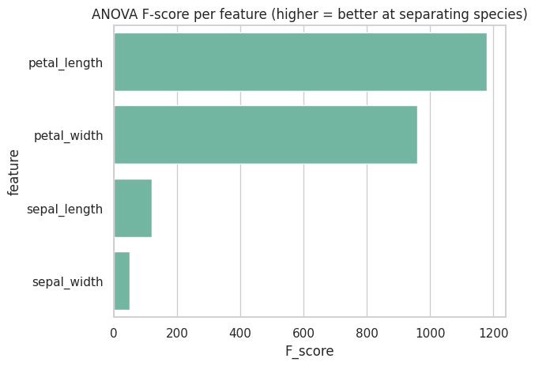
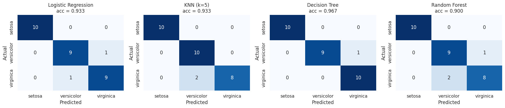
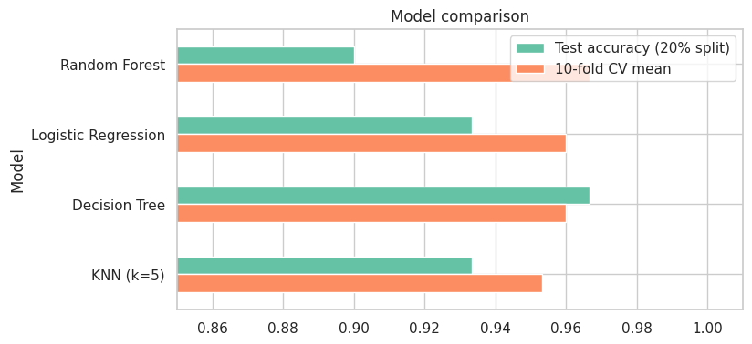
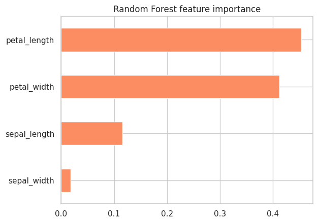

# Task 1: Iris Flower Classification

**Intern:** Zareen Sabri | **Track:** Data Science | **Internship:** Oasis Infobyte (OIBSIP)

## Objective
Train a machine learning model that predicts the species of an iris flower (Setosa, Versicolor or Virginica) from its sepal and petal measurements.

## Dataset
The Iris dataset from `sklearn.datasets.load_iris()`. It has 150 rows (50 per species) and 4 numeric features: sepal length, sepal width, petal length and petal width. There are no missing values and 1 duplicated row. No download is needed.

## What I did
1. Loaded the data into a pandas dataframe and checked shape, data types, null values, duplicates and descriptive statistics (EDA).
2. Made a pairplot and box plots to compare the features across species.
3. Ranked the features with the ANOVA F-score to see which are most useful.
4. Split the data 80/20 (stratified, `random_state=42`).
5. Trained four classifiers: Logistic Regression, KNN, Decision Tree and Random Forest.
6. Evaluated each with accuracy, a confusion matrix and a classification report, and also ran 10-fold cross-validation because the test set is only 30 rows.

## Results

| Model | Test accuracy (20% split) | 10-fold CV mean |
|---|---|---|
| Random Forest | 0.900 | **0.967** |
| Logistic Regression | 0.933 | 0.960 |
| Decision Tree | 0.967 | 0.960 |
| KNN (k=5) | 0.933 | 0.953 |

**Best model: Random Forest**, chosen on the cross-validation score. On the single test split it scored lowest, but with only 30 test rows one wrong prediction changes accuracy by 3.3%, so cross-validation is the more reliable comparison. All four models are within about 2 percentage points of each other.

## Key findings
- Petal length and petal width are the most discriminative features. Sepal width is the weakest.
- Setosa is never misclassified. All mistakes are between Versicolor and Virginica, whose measurements overlap.

## Screenshots








## Files
- `Task1_Iris_Classification.ipynb`: the full notebook with code, charts and written observations
- `model_results.csv`: model comparison table
- `notebook_with_results.html`: the executed notebook as a web page (can be opened without Jupyter)
- the `.png` files: charts from the notebook

## How to run
```bash
pip install -r ../requirements.txt
jupyter notebook Task1_Iris_Classification.ipynb
```
Then choose Kernel > Restart & Run All.
