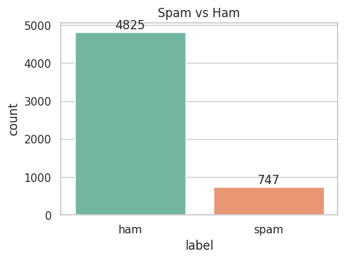
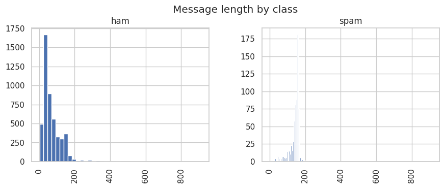
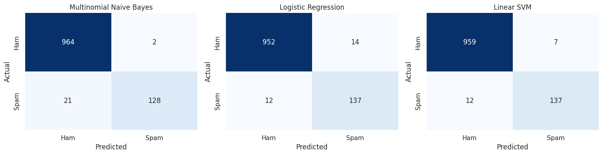
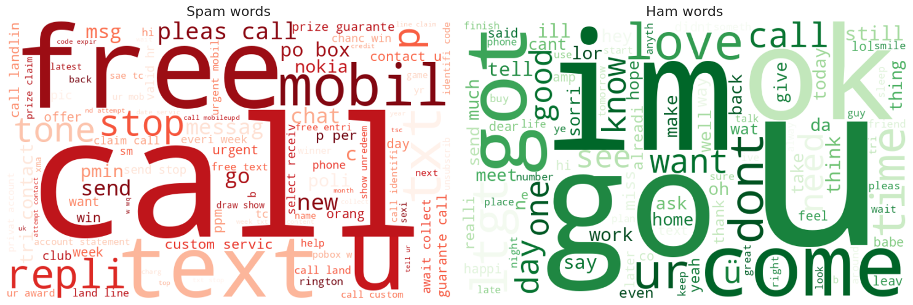
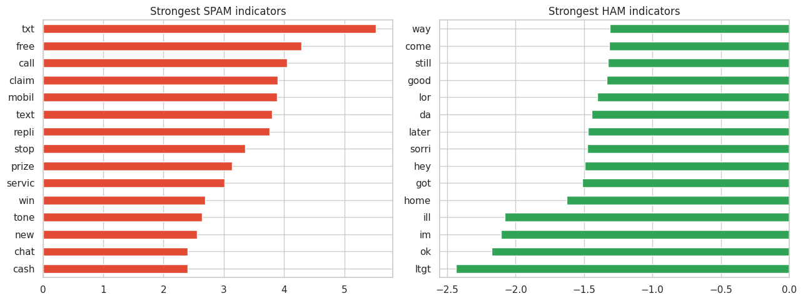

# Task 4: Spam Detection (SMS Spam Collection)

**Intern:** Zareen Sabri | **Track:** Data Science | **Internship:** Oasis Infobyte (OIBSIP)

## Objective
Build an NLP classifier that separates spam messages from legitimate (ham) messages.

## Dataset
The **SMS Spam Collection** (5,572 labelled messages, file `sms.tsv`), also on Kaggle and the UCI Machine Learning Repository.

> **Note:** the task is titled "Email Spam Detection", but its own sourcing guideline recommends the SMS Spam Collection, so the data here is SMS text and not email. The method is the same for emails. The results apply to SMS data.

The data is imbalanced: 86.6% ham (4,825) and 13.4% spam (747). There are 403 duplicate messages, which I kept.

## What I did
1. Checked the class distribution (counts and percentages).
2. Cleaned the text: lowercase, removed numbers and punctuation, removed stopwords, applied Porter stemming. The English stopword list is included in the notebook, so no downloads are needed.
3. Converted the text to numbers with a TF-IDF vectorizer (unigrams and bigrams). The notebook explains what TF-IDF measures.
4. Split the data 80/20 (stratified, `random_state=42`), fitting TF-IDF on the training data only.
5. Trained Multinomial Naive Bayes, Logistic Regression and a Linear SVM.
6. Evaluated with accuracy, precision, recall, F1 and confusion matrices, and wrote up why recall matters for spam detection.
7. Bonus: word clouds for spam and ham words, and the words with the strongest weights in the Logistic Regression model.

## Results (spam class)

| Model | Accuracy | Precision | Recall | F1 |
|---|---|---|---|---|
| Multinomial Naive Bayes | 0.979 | 0.985 | 0.859 | 0.918 |
| Logistic Regression | 0.977 | 0.907 | 0.919 | 0.913 |
| **Linear SVM** | **0.983** | 0.951 | 0.919 | **0.935** |

**Best model: Linear SVM.** It has the highest accuracy and F1, and its recall is tied with Logistic Regression. On the test set (149 spam messages) it caught 137 and missed 12, with 7 false alarms. Naive Bayes had the best precision (2 false alarms) but missed 21 spam messages.

## Key findings
- Because the data is 87% ham, accuracy alone is misleading, so precision, recall and F1 for the spam class matter more.
- Spam messages are much longer on average (about 139 characters against about 72 for ham).
- Words like "txt", "free", "call", "claim" and "mobile" are the strongest spam signals.

## Screenshots







## Files
- `Task4_SMS_Spam_Detection.ipynb`: the full notebook
- `sms.tsv`: the dataset
- `model_results.csv`: model comparison table
- `notebook_with_results.html`: the executed notebook as a web page
- the `.png` files: charts from the notebook

## How to run
```bash
pip install -r ../requirements.txt
jupyter notebook Task4_SMS_Spam_Detection.ipynb
```
Then choose Kernel > Restart & Run All. No other downloads are needed.
