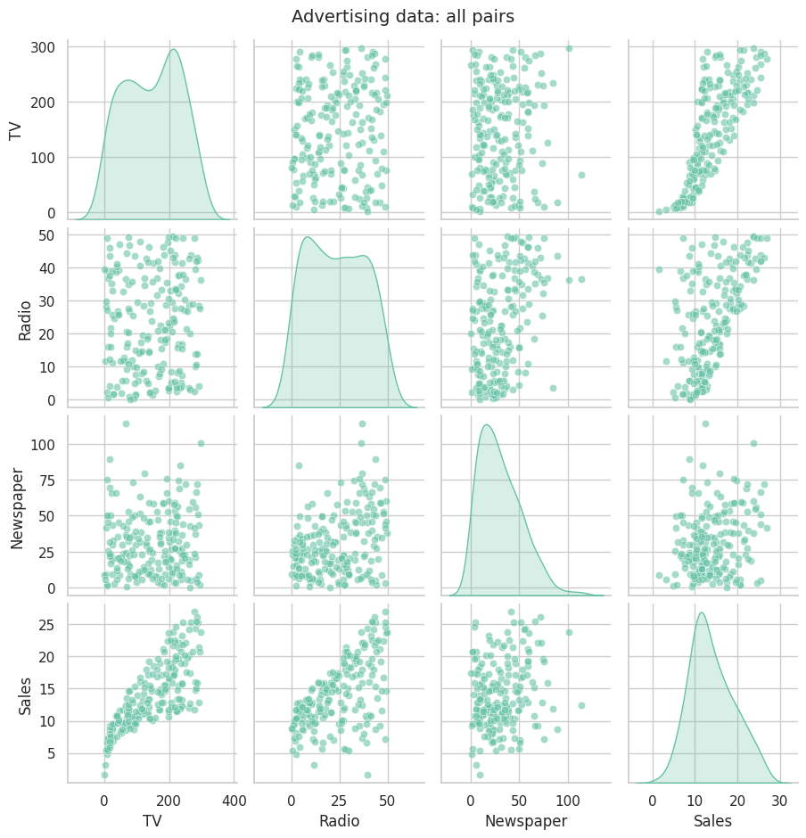
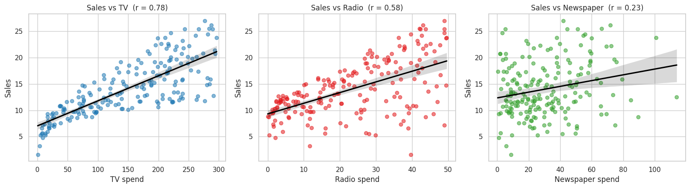
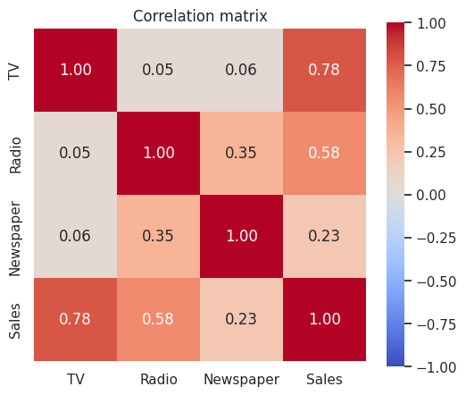
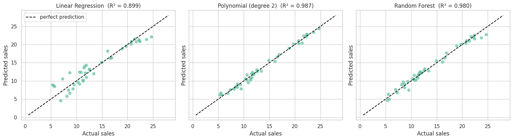
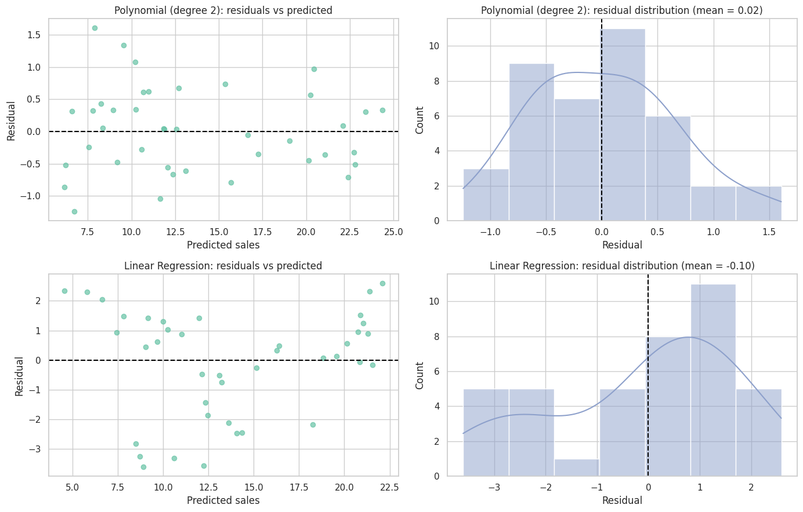
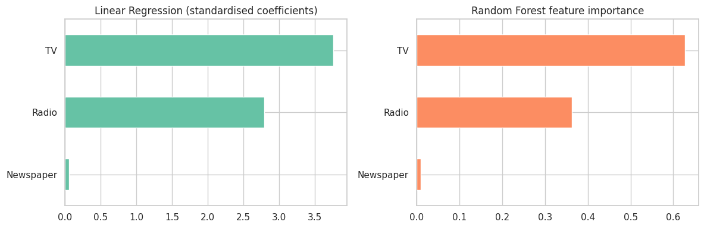

# Task 5: Sales Prediction Using Python

**Intern:** Zareen Sabri | **Track:** Data Science | **Internship:** Oasis Infobyte (OIBSIP)

## Objective
Predict product sales from advertising spend on TV, radio and newspaper, and find out which channel has the biggest impact on sales.

## Dataset
The classic **Advertising** dataset (`Advertising.csv`): 200 markets with TV, Radio and Newspaper spend (in thousands of dollars) and Sales (in thousands of units). No missing values and no duplicates.

## What I did
1. Explored the data: null check, descriptive statistics and a pairplot of all columns.
2. Plotted Sales against each channel separately, and made a correlation heatmap.
3. Split the data 80/20 (`random_state=42`).
4. Trained a Linear Regression baseline, a degree 2 Polynomial Regression and a Random Forest Regressor.
5. Evaluated with MAE, RMSE and R² on the test set, plus 5-fold cross-validated R².
6. Made residual plots for the best model and for the baseline.
7. Worked out channel impact using standardised coefficients and Random Forest feature importance.

## Results

| Model | MAE | RMSE | R² (test) | R² (5-fold CV) |
|---|---|---|---|---|
| **Polynomial (degree 2)** | **0.53** | **0.64** | **0.987** | **0.984** |
| Random Forest | 0.66 | 0.79 | 0.980 | 0.974 |
| Linear Regression | 1.46 | 1.78 | 0.899 | 0.887 |

**Best model: Polynomial Regression (degree 2).** It has the lowest error on every metric, and its residuals are randomly scattered around zero. The Linear Regression residuals form a U-shape, which means a straight line does not fit this data.

## Which channel matters most?

| Channel | Standardised coefficient | Random Forest importance |
|---|---|---|
| TV | 3.76 | 0.628 |
| Radio | 2.79 | 0.362 |
| Newspaper | 0.06 | 0.010 |

TV has the biggest effect, radio is second, and newspaper has almost none once TV and radio are included. Radio gives more sales per dollar (about 0.19 per $1k against 0.045 for TV). The TV x Radio interaction is one of the largest terms in the polynomial model, so the two channels seem to work better together.

This is observational data, so these results show association and not proof of cause.

## Screenshots








## Files
- `Task5_Sales_Prediction.ipynb`: the full notebook
- `Advertising.csv`: the dataset
- `model_results.csv`: model comparison table
- `notebook_with_results.html`: the executed notebook as a web page
- the `.png` files: charts from the notebook

## How to run
```bash
pip install -r ../requirements.txt
jupyter notebook Task5_Sales_Prediction.ipynb
```
Then choose Kernel > Restart & Run All.
